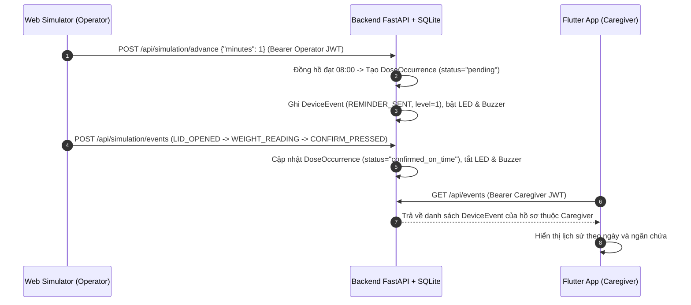
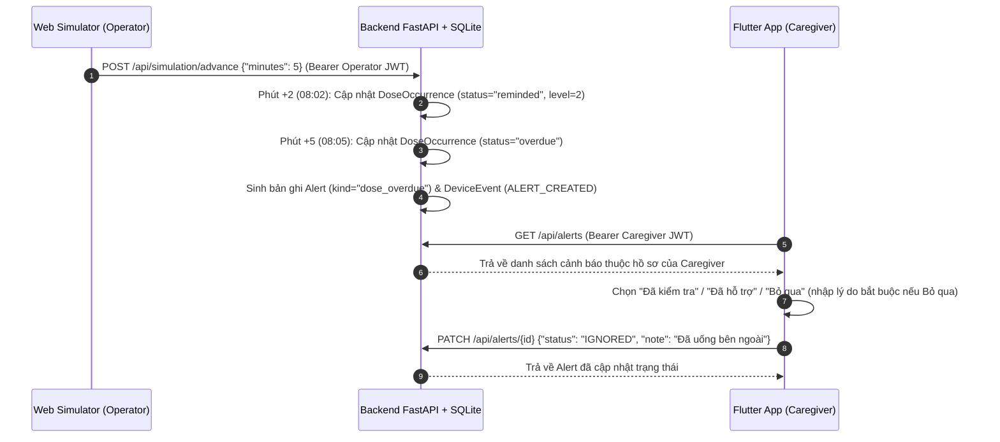

# BÁO CÁO NGHIỆM THU & TỔNG HỢP CÔNG VIỆC ĐÃ LÀM (VAI TRÒ 1 & VAI TRÒ 5)

**Dự án:** Hộp thuốc thông minh (Smart Pill Box)  
**Nhánh làm việc:** `dev-phat` (đã khôi phục và đồng bộ 100% theo nhánh `main` và Đặc tả thống nhất)  
**Phạm vi phụ trách:**  
- **Vai trò 1 (Chủ sở hữu Backend & Database):** Quản lý 7 bảng SQLite chuẩn, Seed Data băm mật khẩu Argon2, xác thực & phân quyền JWT, phân tách thư mục `backend/app/api/` trực quan và hoàn thiện API Quản lý lịch (`/api/schedules`) có kiểm tra chống trùng ngăn/giờ đang bật.  
- **Vai trò 5 (QA, Tài liệu & Flutter Lịch sử/Cảnh báo):** Dùng chung `SmartPillApi` (đính kèm Bearer JWT), phân tách thư mục `flutter-app/lib/api/`, hoàn thiện giao diện `HistoryScreen` (lọc theo ngày & ngăn), giao diện `AlertsScreen` (`CHECKED`, `ASSISTED`, `IGNORED` bắt buộc nhập lý do), và bộ kiểm thử tự động toàn hệ thống.

---

## 1. Tóm tắt các công việc đã thực hiện

### 1.1. Khôi phục & Tối ưu Backend (Vai trò 1)
1. **Khôi phục về chuẩn nhánh `main`:**
   - Đặt lại nhánh `dev-phat` về đúng nền tảng nhánh `main` của nhóm, giữ nguyên toàn bộ logic đồng hồ ảo (`virtual_clock`) và trạng thái thiết bị IoT (`SIM-001`) của Thành viên 2 & 3.
2. **Bảo toàn 7 bảng CSDL SQLite chuẩn (`backend/app/models.py`):**
   - Khôi phục đầy đủ 7 bảng: `users`, `patients`, `medication_schedules`, `dose_occurrences`, `device_events`, `alerts`, `simulation_state`.
3. **Băm mật khẩu Argon2 & Xác thực JWT (`backend/app/api/deps.py`, `backend/app/seed.py`):**
   - Mật khẩu trong `seed_demo.py` được băm bằng `pwdlib.PasswordHash.recommended()` (Argon2), tuyệt đối không lưu plaintext.
   - Mọi API (trừ `/api/health` và `/api/auth/login`) đều kiểm tra JWT Bearer token (`HS256`) và phân quyền `caregiver_only` / `operator_only`.
4. **Kiểm tra phân quyền & Chống trùng lịch uống thuốc (`backend/app/api/schedules.py`):**
   - Chỉ cho phép `caregiver` xem, tạo, sửa lịch của `patients` thuộc quyền quản lý của mình (`patient.caregiver_id == user.id`).
   - Bổ sung kiểm tra chống trùng lịch: Chặn tạo mới (`POST /api/schedules`) hoặc cập nhật/bật lại (`PATCH /api/schedules/{schedule_id}`) nếu có 2 lịch cùng `patient_id`, cùng ngăn (`slot`) và cùng giờ (`time`) đang ở trạng thái `active=true` (trả về mã lỗi `409 Conflict`).
5. **Tách cấu trúc thư mục `backend/app/api/` trực quan, dễ nhận biết và dễ sửa lỗi:**
   ```text
   backend/app/
   ├── main.py                # Khởi tạo FastAPI, CORS, Database và gắn các APIRouter
   ├── models.py              # Định nghĩa 7 bảng SQLAlchemy chuẩn
   ├── schemas.py             # Định nghĩa Pydantic Schemas
   ├── seed.py                # Khởi tạo dữ liệu mẫu với mật khẩu băm Argon2
   └── api/
       ├── deps.py            # Kết nối DB, giải mã JWT, kiểm tra quyền caregiver/operator
       ├── auth.py            # [Vai trò 1] /api/health, /api/auth/login, /api/me
       ├── schedules.py       # [Vai trò 1] /api/patients, GET/POST/PATCH /api/schedules
       └── simulation.py      # [Vai trò 2 & 3] /api/simulation/state, events, advance, reset
   ```

---

### 1.2. Đồng bộ & Phân tách Mã nguồn Flutter (Vai trò 5)
1. **Xóa bỏ `services/api_service.dart` riêng lẻ gây xung đột.**
2. **Dùng chung duy nhất class `SmartPillApi` và tách file trực quan trong `flutter-app/lib/api/`:**
   - Sử dụng cơ chế `part` / `part of` và `extension` của Dart để tách từng mảng API ra file riêng nhưng vẫn dùng chung 1 instance `SmartPillApi` và tự động gắn `Authorization: Bearer $token`:
   ```text
   flutter-app/lib/api/
   ├── smart_pill_api.dart    # Lõi HTTP Client, quản lý JWT token & xử lý lỗi mạng chung
   ├── auth_api.dart          # login(), me() -> /api/auth/login, /api/me
   ├── schedules_api.dart     # patients(), schedules(), createSchedule(), updateSchedule()
   ├── events_api.dart        # [Vai trò 5] events() -> GET /api/events (lọc theo ngăn & ngày)
   └── alerts_api.dart        # [Vai trò 5] alerts(), updateAlert() -> GET/PATCH /api/alerts
   ```
3. **Màn hình Lịch sử (`flutter-app/lib/screens/history_screen.dart`):**
   - Nhận `SmartPillApi` từ `HomeScreen` (có sẵn JWT token sau khi đăng nhập).
   - Hiển thị danh sách sự kiện từ `GET /api/events` kèm bộ lọc theo **Ngăn (`Tất cả ngăn`, `Ngăn 1`, `Ngăn 2`, `Ngăn 3`)** và bộ lọc theo **Ngày (`DatePicker`)**.
4. **Màn hình Cảnh báo (`flutter-app/lib/screens/alerts_screen.dart`):**
   - Hiển thị danh sách cảnh báo từ `GET /api/alerts`.
   - Cho phép nhấn vào cảnh báo để chọn trạng thái xử lý: **Đã kiểm tra (`CHECKED`)**, **Đã hỗ trợ (`ASSISTED`)**, hoặc **Bỏ qua (`IGNORED`)**.
   - **Bắt buộc nhập lý do (`note`)** nếu người dùng chọn **Bỏ qua (`IGNORED`)**, sau đó gửi `PATCH /api/alerts/{id}` kèm JWT token.

---

## 2. Chi tiết 7 Bảng Cơ sở dữ liệu Chuẩn (`backend/app/models.py`)

| STT | Tên bảng | Các cột chính | Mục đích sử dụng |
|---|---|---|---|
| 1 | **`users`** | `id`, `email` (unique), `display_name`, `password_hash`, `role` (`caregiver`/`operator`), `active` | Quản lý tài khoản đăng nhập và phân quyền theo vai trò; mật khẩu băm bằng Argon2 (`pwdlib`). |
| 2 | **`patients`** | `id`, `caregiver_id` (FK $\to$ `users.id`), `name`, `demo` | Hồ sơ người được chăm sóc, gắn chặt với tài khoản `caregiver` quản lý. |
| 3 | **`medication_schedules`** | `id`, `patient_id` (FK $\to$ `patients.id`), `medication_name`, `slot` (1..3), `time` (`HH:mm`), `active`, `created_at` | Lịch uống thuốc theo ngăn (1, 2, 3) và giờ trong ngày của từng hồ sơ. |
| 4 | **`dose_occurrences`** | `id`, `schedule_id` (FK $\to$ `medication_schedules.id`), `scheduled_at`, `confirmed_at`, `status` | Các lần nhắc uống thuốc thực tế sinh ra từ lịch khi đồng hồ chạy qua mốc giờ. |
| 5 | **`device_events`** | `id`, `event_uuid` (unique), `event_type`, `occurrence_id`, `payload` (JSON), `created_at` | Nhật ký sự kiện thiết bị/mô phỏng, có ràng buộc `uq_device_event_uuid` chống trùng lặp (Idempotency). |
| 6 | **`alerts`** | `id`, `patient_id` (FK $\to$ `patients.id`), `occurrence_id`, `kind`, `message`, `created_at`, `resolved_at` | Cảnh báo quá hạn chưa xác nhận uống thuốc gửi tới người thân (`caregiver`). |
| 7 | **`simulation_state`** | `id`, `device_id` (`SIM-001`), `virtual_clock`, `compartments` (JSON), `updated_at` | Lưu trữ trạng thái đồng hồ ảo và 3 ngăn hộp thuốc bền vững qua các lần khởi động lại server. |

---

## 3. Danh sách API Vai trò 1 & Ví dụ JSON Bàn giao

| File quản lý | Phương thức & Đường dẫn | Quyền yêu cầu | Mô tả |
|---|---|---|---|
| `app/api/auth.py` | `GET /api/health` | Công khai | Kiểm tra trạng thái hoạt động của máy chủ. |
| `app/api/auth.py` | `POST /api/auth/login` | Công khai | Đăng nhập bằng `email` và `password`, trả về JWT `access_token` (HS256, thời hạn 8 giờ). |
| `app/api/auth.py` | `GET /api/me` | Bearer JWT | Trả về thông tin tài khoản đang đăng nhập (`id`, `email`, `display_name`, `role`). |
| `app/api/schedules.py` | `GET /api/patients` | `caregiver` | Lấy danh sách hồ sơ người bệnh thuộc quyền quản lý của caregiver đang đăng nhập. |
| `app/api/schedules.py` | `GET /api/schedules` | `caregiver` | Lấy danh sách lịch uống thuốc chỉ của các `patients` thuộc caregiver đó. |
| `app/api/schedules.py` | `POST /api/schedules` | `caregiver` | Tạo lịch uống thuốc mới; kiểm tra quyền sở hữu hồ sơ (`403`) và chặn trùng `(patient_id, slot, time)` đang `active=true` (`409`). |
| `app/api/schedules.py` | `PATCH /api/schedules/{id}` | `caregiver` | Cập nhật tên thuốc, ngăn, giờ hoặc bật/tắt lịch; chặn sửa lịch người khác (`404`) và chặn trùng `(patient_id, slot, time)` khi `active=true` (`409`). |

### Ví dụ JSON Bàn giao cho Nhóm

#### 1) Đăng nhập (`POST /api/auth/login`)
- **Request:**
```json
{
  "email": "caregiver-a@example.test",
  "password": "<DEMO_PASSWORD>"
}
```
- **Response (`200 OK`):**
```json
{
  "access_token": "eyJhbGciOiJIUzI1NiIsInR5cCI6IkpXVCJ9...",
  "token_type": "bearer",
  "expires_in": 28800,
  "user": {
    "id": 1,
    "email": "caregiver-a@example.test",
    "display_name": "Người thân A",
    "role": "caregiver"
  }
}
```

#### 2) Tạo lịch uống thuốc (`POST /api/schedules`)
- **Headers:** `Authorization: Bearer <access_token>`
- **Request:**
```json
{
  "patient_id": 1,
  "medication_name": "Thuốc D",
  "slot": 1,
  "time": "08:10",
  "active": true
}
```
- **Response (`201 Created`):**
```json
{
  "id": 5,
  "patient_id": 1,
  "medication_name": "Thuốc D",
  "slot": 1,
  "time": "08:10",
  "active": true
}
```
- **Response khi trùng ngăn & giờ đang bật (`409 Conflict`):**
```json
{
  "detail": "Đã có lịch uống thuốc đang bật trùng ngăn và giờ cho hồ sơ này"
}
```

---

## 4. Sáu (6) Ca Kiểm thử Bảo mật (Threat Model) Đã Khắc phục & Kiểm chứng

Toàn bộ các lỗ hổng bảo mật ở nhánh cũ đã được khắc phục triệt để và có kiểm thử tự động trong `backend/tests/test_api.py`:

1. **Cấm truy cập API khi không có Token hoặc Token giả mạo (Authentication Bypass - `401 Unauthorized`):**
   - *Mô tả:* Mọi truy vấn tới `/api/me`, `/api/patients`, `/api/schedules`, `/api/simulation/*` nếu thiếu header `Authorization: Bearer <token>` hoặc dùng token sai chữ ký `JWT_SECRET` đều bị chặn bởi `require_user` với mã lỗi `401`.
2. **Chặn người thân A xem hoặc tạo/sửa lịch của người thân B (Broken Object Level Authorization / BOLA - `403` & `404`):**
   - *Mô tả:* Khi `caregiver-a` gọi `GET /api/schedules`, hệ thống chỉ lọc các `patient_id` có `caregiver_id == user.id`. Nếu `caregiver-a` cố tình gửi `POST /api/schedules` với `patient_id` của `caregiver-b`, API lập tức trả về `403 Forbidden`. Nếu cố tình `PATCH /api/schedules/{schedule_b_id}`, API trả về `404 Not Found`.
3. **Chặn leo thang đặc quyền giữa Caregiver và Operator (Broken Function Level Authorization - `403 Forbidden`):**
   - *Mô tả:* Tài khoản `caregiver` không thể gọi các API điều khiển phần cứng mô phỏng (`/api/simulation/state`, `/api/simulation/events`, `/api/simulation/clock`, `/api/simulation/reset` $\to$ `403`), và ngược lại `operator` không thể thao tác lên dữ liệu lịch của `caregiver`.
4. **Bảo vệ mật khẩu bằng thuật toán băm Argon2 (Cryptographic Failures):**
   - *Mô tả:* Loại bỏ hoàn toàn việc lưu mật khẩu dạng rõ (plaintext). Mật khẩu được băm bằng `pwdlib.PasswordHash.recommended()` (Argon2id) khi seed và được kiểm tra bằng `password_hasher.verify()` khi đăng nhập.
5. **Chặn xung đột lịch uống thuốc trùng ngăn & trùng giờ đang bật (Business Logic Integrity - `409 Conflict`):**
   - *Mô tả:* Khi tạo mới (`POST /api/schedules`) hoặc cập nhật/bật lại (`PATCH /api/schedules/{id}`), nếu đã tồn tại một lịch khác đang `active=true` có cùng `patient_id`, cùng `slot` và cùng `time`, hệ thống từ chối với mã `409 Conflict` để ngăn thiết bị nhắc chồng chéo.
6. **Chống gửi lặp hoặc giả mạo lại sự kiện bằng `event_uuid` (Replay / Idempotency Protection - `409 Conflict`):**
   - *Mô tả:* Mỗi sự kiện thiết bị đều gắn `event_uuid` duy nhất. Gửi lại cùng `event_uuid` với cùng nội dung sẽ trả về trạng thái `idempotent: true` mà không trừ thuốc 2 lần; gửi lại cùng `event_uuid` nhưng thay đổi nội dung bị chặn bằng lỗi `409 Conflict`.

---

## 5. Sơ đồ Tuần tự (Sequence Diagrams)

### Luồng A: Nhắc uống thuốc và xác nhận thành công


### Luồng B: Quá hạn không phản hồi, tạo cảnh báo và người thân xử lý


---

## 6. Kết quả Kiểm thử Tự động (QA Verification)

1. **Backend Pytest (`backend`):**
   ```bash
   cd backend
   ./.venv/bin/python -m pytest -v
   ```
   - Kết quả: **`5 passed`** (kiểm tra đủ 7 bảng, phân quyền JWT, chặn trùng lịch POST/PATCH, idempotency `event_uuid`, ngưỡng nhiễu cân `0.3g`, và bảo toàn dữ liệu khi khởi động lại server).
2. **Flutter Static Analysis & Widget Tests (`flutter-app`):**
   ```bash
   cd flutter-app
   flutter analyze
   flutter test
   ```
   - Kết quả `flutter analyze`: **`No issues found!`**
   - Kết quả `flutter test`: **`All tests passed! (3/3)`** (kiểm tra màn hình đăng nhập, bộ lọc theo ngăn ở `HistoryScreen`, và bắt buộc nhập lý do khi chọn `Bỏ qua` ở `AlertsScreen`).
