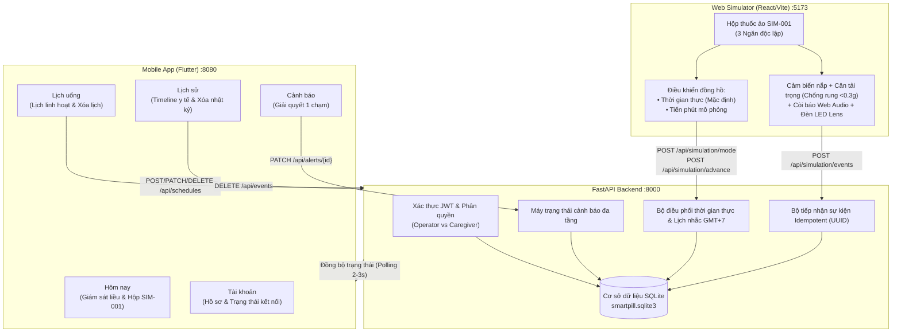

# Smart Pill Box — Hệ Thống Hộp Thuốc Thông Minh IoT

> [!NOTE]
> **Hệ sinh thái y tế toàn diện:** Backend FastAPI + Web Simulator phần cứng 3D + Ứng dụng di động Flutter dành cho người thân/người chăm sóc.

> [!IMPORTANT]
> **Quy chuẩn cập nhật mới nhất:**
> - **100% Tiếng Việt chuẩn y tế:** Loại bỏ hoàn toàn các thuật ngữ tiếng Anh rải rác trên giao diện.
> - **Mô hình gói thuốc chia sẵn thực tế:** Chuẩn hóa việc phân chia và quản lý theo từng cữ/gói thuốc chia sẵn thay vì đếm viên rời.
> - **Chế độ Thời gian thực (REALTIME) mặc định:** Tự động điều phối và kiểm tra nhắc thuốc theo múi giờ Việt Nam (GMT+7) liên tục.
> - **Còi báo âm thanh y tế Web Audio API:** Âm thanh còi cảnh báo y tế tự sinh theo nhịp khẩn cấp, có chế độ phát thử.
> - **Lịch uống linh hoạt:** Tùy chọn uống mỗi ngày, 2-4-6, 3-5-7 hoặc chọn từng thứ trong tuần.
> - **Quản lý toàn diện:** Cho phép xóa lịch uống và xóa sạch nhật ký sự kiện đồng bộ trên Backend, Flutter App và Web Simulator.

---

## Mục lục
1. [Khởi động nhanh](#1-khởi-động-nhanh)
2. [Địa chỉ dịch vụ & Tài khoản mẫu](#2-địa-chỉ-dịch-vụ--tài-khoản-mẫu)
3. [Kiến trúc hệ thống & Stack công nghệ](#3-kiến-trúc-hệ-thống--stack-công-nghệ)
4. [Hướng dẫn cài đặt chi tiết từng phân hệ](#4-hướng-dẫn-cài-đặt-chi-tiết-từng-phân-hệ)
5. [Kịch bản vận hành chuẩn y tế](#5-kịch-bản-vận-hành-chuẩn-y-tế)
6. [Đặc tả API & Quy chuẩn kỹ thuật](#6-đặc-tả-api--quy-chuẩn-kỹ-thuật)
7. [Bằng chứng kiểm thử & Quality Gates](#7-bằng-chứng-kiểm-thử--quality-gates)

---

## 1. Khởi động nhanh

### Yêu cầu môi trường tối thiểu
- **Python 3.10+**
- **Node.js 18+** & npm
- **Flutter SDK 3.x+**

---

### Cách 1: Khởi động 1-Click trên Windows (Khuyến nghị)

> [!TIP]
> Sử dụng các tệp batch tự động để thiết lập và chạy toàn bộ dự án chỉ với 2 lần nhấp chuột:

1. **Cài đặt lần đầu:**
   Chạy tệp:
   ```cmd
   setup.bat
   ```
   *Script tự động thiết lập Python `.venv`, cài đặt `requirements.txt`, tạo `.env`, nạp dữ liệu SQLite mẫu, cài đặt npm packages và Flutter dependencies.*

2. **Khởi chạy cả 3 dịch vụ:**
   Chạy tệp:
   ```cmd
   start_all.bat
   ```
   *Mở đồng thời 3 cửa sổ riêng biệt: Backend (:8000), Web Simulator (:5173), Flutter Web (:8080).*

---

### Cách 2: Khởi động thủ công qua dòng lệnh

#### Cửa sổ 1 — Backend API (FastAPI)
```powershell
cd backend
python -m venv .venv
.\.venv\Scripts\activate
pip install -r requirements.txt
Copy-Item .env.example .env
python scripts\seed_demo.py
python -m uvicorn app.main:app --host 0.0.0.0 --port 8000
```

#### Cửa sổ 2 — Web Simulator (React + TypeScript)
```powershell
cd web-simulator
npm install
npm run dev
```

#### Cửa sổ 3 — Flutter Caregiver App (Flutter Web)
```powershell
cd flutter-app
flutter pub get
flutter run -d web-server --web-port 8080 --web-hostname 127.0.0.1
```

---

## 2. Địa chỉ dịch vụ & Tài khoản mẫu

| Phân hệ | Đường dẫn truy cập | Vai trò | Ghi chú |
| :--- | :--- | :--- | :--- |
| **Backend API Docs** | [http://localhost:8000/docs](http://localhost:8000/docs) | Máy chủ API | Tài liệu tương tác Swagger UI |
| **Web Simulator** | [http://localhost:5173](http://localhost:5173) | Người vận hành | Bàn điều khiển thiết bị hộp thuốc SIM-001 |
| **Flutter App (Web)** | [http://localhost:8080](http://localhost:8080) | Người thân | Ứng dụng theo dõi, cài đặt lịch & cảnh báo |

### Danh sách tài khoản thử nghiệm

| Tài khoản | Email đăng nhập | Mật khẩu mặc định | Mục đích sử dụng |
| :--- | :--- | :--- | :--- |
| **Người vận hành (Operator)** | `operator@example.test` | `Password123!` | Đăng nhập **Web Simulator** để thao tác mở nắp, lấy gói thuốc, nạp thêm, bấm xác nhận và đổi chế độ đồng hồ. |
| **Người thân A (Caregiver A)** | `caregiver-a@example.test` | `Password123!` | Đăng nhập **Flutter App** để quản lý lịch, theo dõi lượt uống hôm nay và xử lý cảnh báo của Bệnh nhân A (SIM-001). |
| **Người thân B (Caregiver B)** | `caregiver-b@example.test` | `Password123!` | Kiểm thử đa người dùng & cách ly dữ liệu bảo mật giữa các hồ sơ gia đình. |

> [!NOTE]
> Cả trên Web Simulator và Flutter App đều có nút **"Điền nhanh"** hỗ trợ đăng nhập 1 chạm tiện dụng.

---

## 3. Kiến trúc hệ thống & Stack công nghệ



### Stack công nghệ
- **Backend:** Python 3.12, FastAPI, SQLAlchemy 2.0, Pydantic v2, PyJWT, pwdlib (Argon2), Uvicorn.
- **Web Simulator:** React 18, TypeScript, Vite, CSS 3D Glassmorphism, Web Audio API.
- **Mobile App:** Flutter 3.x, Dart 3.x, Material Design 3.
- **Kiểm thử tự động:** Pytest, Flutter Widget Test, Chrome DevTools Protocol (CDP Automation).

---

## 4. Hướng dẫn cài đặt chi tiết từng phân hệ

### Phân hệ 1: Backend API (`backend/`)
1. Di chuyển vào thư mục:
   ```powershell
   cd backend
   ```
2. Tạo và kích hoạt môi trường ảo:
   - **Windows:**
     ```powershell
     python -m venv .venv
     .\.venv\Scripts\activate
     ```
   - **macOS / Linux:**
     ```bash
     python3 -m venv .venv
     source .venv/bin/activate
     ```
3. Cài đặt các thư viện:
   ```bash
   pip install -r requirements.txt
   ```
4. Thiết lập tệp cấu hình `.env`:
   ```powershell
   copy .env.example .env
   ```
   Nội dung trong `.env`:
   ```ini
   DATABASE_URL=sqlite:///data/smartpill.sqlite3
   JWT_SECRET=WFRDkdlpF9ovHEYdr1sNSgQC0NBsfY7TrRlznv2K56FKLdge5FDc0WqQCBnU72l-
   DEMO_PASSWORD=Password123!
   ```
5. Khởi tạo cơ sở dữ liệu mẫu:
   ```bash
   python scripts/seed_demo.py
   ```
6. Khởi động máy chủ:
   ```bash
   python -m uvicorn app.main:app --host 0.0.0.0 --port 8000
   ```
   > Tài liệu Swagger UI: [http://localhost:8000/docs](http://localhost:8000/docs)

---

### Phân hệ 2: Web Simulator (`web-simulator/`)
1. Di chuyển vào thư mục:
   ```powershell
   cd web-simulator
   ```
2. Cài đặt các gói phụ thuộc Node:
   ```bash
   npm install
   ```
3. Khởi động máy chủ phát triển Vite:
   ```bash
   npm run dev
   ```
   > Truy cập bàn điều khiển: [http://localhost:5173](http://localhost:5173)

---

### Phân hệ 3: Flutter Caregiver App (`flutter-app/`)
1. Di chuyển vào thư mục:
   ```powershell
   cd flutter-app
   ```
2. Tải các package Flutter:
   ```bash
   flutter pub get
   ```
3. Chạy ứng dụng:
   - **Chạy trên nền tảng Web:**
     ```bash
     flutter run -d web-server --web-port 8080 --web-hostname 127.0.0.1
     ```
     > Truy cập: [http://localhost:8080](http://localhost:8080)
   - **Chạy trên Android Emulator:**
     ```bash
     flutter run --dart-define=API_BASE_URL=http://10.0.2.2:8000
     ```
   - **Chạy trên thiết bị thật (cùng mạng LAN/Wi-Fi):**
     ```bash
     flutter run --dart-define=API_BASE_URL=http://<IP_MAY_TINH>:8000
     ```

---

## 5. Kịch bản vận hành chuẩn y tế

```
[TRẠNG THÁI CHỜ]: 
Hộp đóng nắp, tải trọng 5.0g (10 gói chia sẵn x 0.5g), Đèn LED tắt, Còi im lặng.
   │
   ▼
[ĐẾN GIỜ UỐNG THUỐC]:
├─ Backend: Tự động kích hoạt lượt uống (trạng thái: "Đang nhắc uống")
├─ Simulator: Đèn LED ngăn tương ứng nhấp nháy, Còi báo y tế phát âm thanh chuông cảnh báo
└─ Mobile App: Màn hình "Hôm nay" chuyển sang màu cam, hiển thị thẻ "Đang nhắc uống"
   │
   ▼ (+2 phút tiếp theo nếu chưa uống)
[NHẮC LẠI LẦN 2]:
├─ Backend: Cập nhật lượt uống sang trạng thái "Đã nhắc lại (2 phút)"
└─ Simulator: Duy trì chuông cảnh báo khẩn trương hơn
   │
   ▼ (+3 phút tiếp theo nếu vẫn chưa uống)
[CẢNH BÁO QUÁ HẠN]:
├─ Backend: Chuyển lượt uống sang "Quá hạn", tự động tạo Alert PENDING gửi đến người thân
├─ Mobile App: Huy hiệu đỏ xuất hiện trên tab "Cảnh báo", hiển thị thẻ cảnh báo khẩn cấp
└─ Người thân: Bấm vào cảnh báo -> Chọn giải pháp xử lý nhanh ("Đã gọi điện nhắc") -> Trạng thái chuyển "Đã kiểm tra"
   │
   ▼ (Thao tác thực tế của người bệnh tại hộp thuốc)
[BỆNH NHÂN UỐNG THUỐC]:
1. Mở nắp ngăn: Gửi sự kiện LID_OPENED (Nắp hiển thị trạng thái Mở).
2. Lấy 1 gói thuốc: Trọng lượng giảm 0.5g -> Cảm biến cân gửi WEIGHT_READING (Số gói giảm còn 9 gói).
3. Bấm nút xác nhận trên vỏ hộp: Gửi sự kiện CONFIRM_PRESSED.
└─ Kết quả: Lượt uống chuyển thành "Đã xác nhận đúng hạn" (hoặc trễ), Đèn LED tắt, Còi tắt hoàn toàn.
```

---

## 6. Đặc tả API & Quy chuẩn kỹ thuật

### Bảng Endpoint chính

| Phương thức | Đường dẫn API | Phân quyền | Mô tả chức năng |
| :--- | :--- | :---: | :--- |
| `POST` | `/api/auth/login` | Công khai | Đăng nhập cấp mã phiên Bearer JWT. |
| `GET` | `/api/schedules` | Người thân | Lấy danh sách lịch uống thuốc của bệnh nhân. |
| `POST` | `/api/schedules` | Người thân | Thêm lịch mới (Chống trùng giờ/ngăn, hỗ trợ chọn thứ trong tuần). |
| `PATCH` | `/api/schedules/{id}` | Người thân | Cập nhật tên thuốc/gói chia sẵn, giờ uống, thứ trong tuần, bật/tắt. |
| `DELETE` | `/api/schedules/{id}` | Người thân | **Xóa lịch uống thuốc** (Hủy các lần nhắc liên kết chưa hoàn thành). |
| `GET` | `/api/doses` | Người thân | Lấy danh sách lượt uống hôm nay theo ngày/ngăn. |
| `GET` | `/api/alerts` | Người thân | Lấy danh sách cảnh báo quá hạn của bệnh nhân. |
| `PATCH` | `/api/alerts/{id}` | Người thân | Xử lý cảnh báo (`CHECKED`, `ASSISTED`, `IGNORED` có lý do bắt buộc). |
| `GET` | `/api/events` | Người thân | Xem nhật ký sự kiện cảm biến hộp thuốc (lọc theo ngăn/ngày). |
| `DELETE` | `/api/events` | Người thân | **Xóa sạch nhật ký sự kiện** trên máy chủ và thiết bị. |
| `GET` | `/api/simulation/state` | Người vận hành | Lấy toàn bộ trạng thái thiết bị (đồng hồ, cân, LED, nắp, còi, số gói). |
| `POST` | `/api/simulation/events` | Người vận hành | Gửi thao tác phần cứng (`LID_OPENED`, `WEIGHT_READING`, `CONFIRM_PRESSED`, `PILL_REFILLED`). |
| `POST` | `/api/simulation/mode` | Người vận hành | Chuyển đổi giữa chế độ `REALTIME` (thời gian thực) và `SIMULATION` (mô phỏng). |
| `POST` | `/api/simulation/advance`| Người vận hành | Tiến đồng hồ mô phỏng thêm $N$ phút. |
| `POST` | `/api/simulation/reset` | Người vận hành | Đặt lại trạng thái mô phỏng ban đầu. |

---

## 7. Bằng chứng kiểm thử & Quality Gates

Toàn bộ hệ thống được kiểm thử tự động, nghiêm ngặt qua 4 lớp kiểm tra chất lượng:

```
========================================================================================
                             BÁO CÁO KIỂM THỬ HỆ THỐNG TOÀN DIỆN
========================================================================================
 [PASS] Backend Pytest Suite               : 21/21 PASSED    (100% Logic, Auth, Lịch, Realtime, Refill)
 [PASS] Flutter Widget & Unit Tests        : 3/3 PASSED      (100% Đầy đủ 5 tabs, Xóa lịch, Xóa sự kiện)
 [PASS] Flutter Static Analysis            : 0 ISSUES        (Hoàn toàn sạch cảnh báo/linter)
 [PASS] Web Simulator Production Build     : PASSED          (TypeScript tsc -b + Vite build thành công)
 [PASS] Chrome DevTools Protocol Audit     : 12/12 PASSED    (Console sạch, 0 lỗi mạng, UI đồng bộ tức thời)
========================================================================================
```

### Lệnh chạy kiểm thử nhanh

```powershell
# Kiểm thử Backend:
cd backend
.\.venv\Scripts\python.exe -m pytest tests -q

# Kiểm thử Flutter:
cd flutter-app
flutter analyze
flutter test

# Kiểm thử Web Simulator Build:
cd web-simulator
npm run build
```

---
*Dự án phát triển bởi nhóm sinh viên — Smart Pill Box System 2026.*
