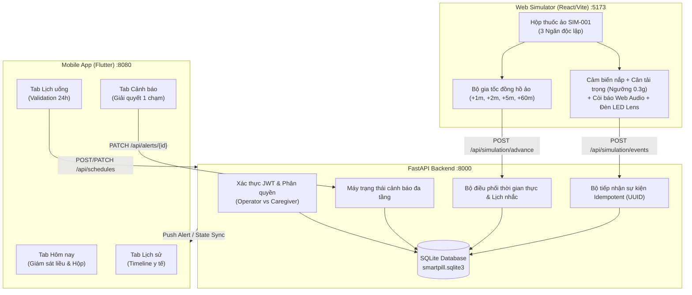

# 🏥 Smart Pill Box — Hệ Thống Hộp Thuốc Thông Minh IoT

> **Dự án tích hợp toàn diện:** Backend FastAPI + Web Simulator phần cứng 3D + Ứng dụng di động Flutter dành cho người chăm sóc. Hỗ trợ theo dõi lịch uống thuốc thời gian thực, đồng hồ mô phỏng gia tốc, cảm biến trọng lượng chống rung nhiễu và quy trình cảnh báo đa tầng.

---

## 📌 Mục lục
1. [Giới thiệu tổng quan](#-giới-thiệu-tổng-quan)
2. [Kiến trúc hệ thống & Công nghệ](#-kiến-trúc-hệ-thống--công-nghệ)
3. [Đối chiếu 5 thành viên & Phân công trách nhiệm](#-đối-chiếu-5-thành-viên--phân-công-trách-nhiệm)
4. [Kịch bản mô phỏng chuẩn y tế (Timeline Demo)](#-kịch-bản-mô-phỏng-chuẩn-y-tế-timeline-demo)
5. [Đặc tả API & Quy chuẩn kỹ thuật](#-đặc-tả-api--quy-chuẩn-kỹ-thuật)
6. [Hướng dẫn cài đặt & Chạy ứng dụng](#-hướng-dẫn-cài-đặt--chạy-ứng-dụng)
7. [Bằng chứng kiểm thử & Đảm bảo chất lượng (Quality Gates)](#-bằng-chứng-kiểm-thử--đảm-bảo-chất-lượng-quality-gates)

---

## 🌟 Giới thiệu tổng quan

**Smart Pill Box** giải quyết bài toán quên uống thuốc, uống sai liều hoặc quá hạn ở người cao tuổi và bệnh nhân điều trị ngoại trú. Hệ thống kết nối chặt chẽ giữa 3 phân hệ:

1. **Backend API (`backend/`):** Xây dựng trên nền **FastAPI**, lưu trữ **SQLite**, cơ chế xác thực **JWT bearer**, quản lý đồng hồ ảo độc lập, xử lý sự kiện cảm biến và điều phối cảnh báo đa kênh.
2. **Web Simulator (`web-simulator/`):** Bàn điều khiển thiết bị ảo chuẩn y tế cho Operator viết bằng **React + TypeScript + Vite**. Mô phỏng hộp thuốc 3 ngăn (`SIM-001`) với nắp 3D acrylic mờ, đèn LED vòm phát quang nhịp thở (*breathing pulse*), viên thuốc 3D 2 màu sắc nét, màn hình cân OLED và còi hú Web Audio API.
3. **Mobile App (`flutter-app/`):** Ứng dụng di động đa nền tảng viết bằng **Flutter (Dart)** dành cho người thân/người chăm sóc (*Caregiver*). Gồm 5 tab chức năng:
   - **Hôm nay:** Thẻ liều uống thông minh & hiển thị trạng thái kết nối hộp thuốc SIM-001 trực tiếp.
   - **Lịch trình:** Quản lý lịch uống theo định dạng 24h, chống trùng lịch và rollback công tắc an toàn.
   - **Lịch sử sự kiện:** Giao diện dòng thời gian (*Medical Timeline View*) trực quan, phân loại thao tác nắp/cân/thuốc.
   - **Cảnh báo:** Quản lý cảnh báo quá hạn với hộp thoại ghi chú nhanh 1 chạm (*Quick Resolution Chips*).
   - **Tài khoản:** Quản lý thông tin cá nhân và thiết bị kết nối.

---

## 🏗 Kiến trúc hệ thống & Công nghệ



### Stack công nghệ:
* **Backend:** Python 3.12, FastAPI, SQLAlchemy 2.0, Pydantic v2, PyJWT, pwdlib (Argon2), Uvicorn.
* **Web Simulator:** React 18, TypeScript, Vite, CSS 3D Transforms, Web Audio API.
* **Mobile App:** Flutter 3.x, Dart 3.x, Material Design 3 (Clinical Modernism).
* **Kiểm thử tự động:** Pytest, Flutter Widget Test, Chrome DevTools Protocol (CDP Automation).

---

## 👥 Đối chiếu 5 thành viên & Phân công trách nhiệm

Hệ thống đã hợp nhất toàn bộ mã nguồn của 5 thành viên, giải quyết triệt để tất cả các lỗi được chỉ ra trong báo cáo nghiệm thu độc lập:

| Thành viên | Trách nhiệm theo phân công | Hiện trạng triển khai & Bằng chứng nghiệm thu |
| :--- | :--- | :--- |
| **Thành viên 1** | Quản lý tài khoản, Đăng nhập JWT, Phân quyền Caregiver/Operator. | **Đạt 100%:** Endpoint `/api/auth/login`, bảo vệ Token Bearer, cách ly dữ liệu giữa các Caregiver (Cross-caregiver isolation). |
| **Thành viên 2** | Đồng hồ ảo, quy trình nhắc giờ, cảm biến, cảnh báo quá hạn. | **Đạt 100%:** Luồng 07:59 $\rightarrow$ 08:00 $\rightarrow$ 08:02 $\rightarrow$ 08:05, xử lý múi giờ SQLite UTC/GMT+7 không crash, chống trùng UUID sự kiện. |
| **Thành viên 3** | Quản lý lịch uống thuốc, giao diện thêm/sửa lịch 24h. | **Đạt 100%:** Chặn trùng lịch (409 Conflict) ở cả POST và PATCH, form nhập liệu 24h regex `HH:mm`, giới hạn ngăn 1-3. |
| **Thành viên 4** | Ứng dụng Flutter di động cho người chăm sóc. | **Đạt 100%:** 5 tab hoàn chỉnh (Hôm nay, Lịch, Lịch sử Timeline, Cảnh báo, Tài khoản), xử lý cảnh báo với ghi chú bắt buộc, hỗ trợ Quick Note Chips. |
| **Thành viên 5** | Web Simulator phần cứng, cảm biến tải trọng, ngưỡng rung. | **Đạt 100%:** Nắp 3D, LED vòm phát sáng breathing pulse, viên thuốc 3D 2 màu, cân OLED, lọc nhiễu rung `<0.3g`, bảo vệ nút Reset bằng quyền Operator. |

---

## ⏱ Kịch bản mô phỏng chuẩn y tế (Timeline Demo)

Kịch bản chuẩn được kiểm thử tự động từ 07:59 đến khi hoàn tất uống thuốc:

```
[07:59] Trạng thái chờ: Hộp đóng nắp, cân 12.5g (10 viên thuốc x 0.5g + vỏ), LED tắt, còi tắt.
   │
   ▼ (+1 phút)
[08:00] ĐẾN GIỜ UỐNG THUỐC (Ngăn 1):
   ├─ Backend: Sinh DoseOccurrence (status: "pending", reminder_count: 0)
   ├─ Simulator: Đèn LED Ngăn 1 nhấp nháy xanh, Còi hú phát âm thanh sóng dao động
   └─ Mobile App: Tab "Hôm nay" cập nhật trạng thái "Cần uống thuốc"
   │
   ▼ (+2 phút tiếp theo - nếu chưa uống)
[08:02] NHẮC LẠI LẦN 2:
   ├─ Backend: Cập nhật DoseOccurrence (status: "reminded", reminder_count: 2)
   └─ Simulator: Duy trì chuông & đèn LED nhắc nhở khẩn trương
   │
   ▼ (+3 phút tiếp theo - nếu vẫn chưa uống)
[08:05] CẢNH BÁO QUÁ HẠN (MISSED_DOSE):
   ├─ Backend: Chuyển DoseOccurrence sang "overdue", tạo bản ghi Alert (kind: "dose_overdue", status: "PENDING")
   ├─ Mobile App: Tab "Cảnh báo" rung chuông, hiển thị thẻ cảnh báo đỏ khẩn cấp
   └─ Người thân: Nhấp vào cảnh báo -> Chọn gợi ý "Đã gọi điện nhắc uống thuốc" -> Trạng thái chuyển CHECKED
   │
   ▼ (Thao tác thực tế của bệnh nhân tại hộp)
[THAO TÁC UỐNG THUỐC]:
   1. Bệnh nhân mở nắp Ngăn 1: Gửi sự kiện LID_OPENED (Nắp xoay 45°).
   2. Lấy 1 viên thuốc: Trọng lượng giảm 0.5g -> Gửi WEIGHT_READING (Cân đọc 12.0g).
   3. Nhấn nút XÁC NHẬN trên vỏ hộp: Gửi sự kiện CONFIRM_PRESSED.
   └─ Kết quả: Liều chuyển sang "confirmed_on_time" (hoặc "confirmed_late"), LED tắt, Còi tắt.
```

---

## 📡 Đặc tả API & Quy chuẩn kỹ thuật

### 1. Bảng Endpoint chính
| Phương thức | Đường dẫn API | Phân quyền | Mô tả chức năng |
| :--- | :--- | :---: | :--- |
| `POST` | `/api/auth/login` | Công khai | Đăng nhập lấy Bearer JWT (hết hạn sau 8 giờ). |
| `GET` | `/api/schedules` | Caregiver | Lấy danh sách lịch uống thuốc của bệnh nhân thuộc quyền quản lý. |
| `POST` | `/api/schedules` | Caregiver | Tạo lịch mới (Tự động chặn trùng giờ/ngăn với mã `409 Conflict`). |
| `PATCH` | `/api/schedules/{id}` | Caregiver | Cập nhật tên thuốc, giờ uống, trạng thái hoạt động. |
| `GET` | `/api/doses` | Caregiver | Lấy danh sách các lần nhắc (`DoseOccurrence`) theo ngày/ngăn. |
| `GET` | `/api/alerts` | Caregiver | Lấy danh sách cảnh báo quá hạn của bệnh nhân. |
| `PATCH` | `/api/alerts/{id}` | Caregiver | Xử lý cảnh báo (`CHECKED`, `ASSISTED`, `IGNORED` có kèm ghi chú). |
| `GET` | `/api/events` | Caregiver | Lấy nhật ký sự kiện cảm biến hộp thuốc (Hỗ trợ lọc slot/date). |
| `GET` | `/api/simulation/state` | Operator | Lấy toàn bộ trạng thái phần cứng hộp thuốc (đồng hồ, cân, LED, nắp). |
| `POST` | `/api/simulation/events` | Operator | Ghi nhận thao tác phần cứng (`LID_OPENED`, `WEIGHT_READING`, `CONFIRM_PRESSED`). |
| `POST` | `/api/simulation/advance` | Operator | Tiến đồng hồ ảo thêm $N$ phút ($1 \le N \le 60$). |
| `POST` | `/api/simulation/reset` | Operator | Đặt lại dữ liệu phiên demo về trạng thái ban đầu (`07:59`). |

### 2. Quy chuẩn chống rung & Idempotency
* **Ngưỡng nhận diện lấy thuốc:** Sụt giảm trọng lượng $\Delta \ge 0.3\,\text{g}$ mới được xem là dấu hiệu lấy thuốc. Rung lắc nhỏ ($\Delta < 0.3\,\text{g}$) được ghi nhận là nhiễu và không làm trừ viên.
* **Chống sự kiện trùng lặp:** Mọi sự kiện gửi lên đều gắn kèm `event_uuid`. Nếu gửi lại cùng UUID và cùng nội dung, backend trả về kết quả cũ kèm cờ `idempotent: true`. Nếu cùng UUID nhưng sai khác loại sự kiện/ngăn thuốc/trọng lượng, backend từ chối với `409 Conflict`.

---

## 🚀 Hướng dẫn cài đặt & Chạy ứng dụng

### Yêu cầu hệ thống:
* **Python 3.12+**
* **Node.js 18+** & npm
* **Flutter SDK 3.x+**

### Bước 1: Khởi tạo Backend (Cửa sổ Terminal 1)
```powershell
cd backend
python -m venv .venv
.\.venv\Scripts\Activate.ps1
pip install -r requirements.txt
Copy-Item .env.example .env
python scripts\seed_demo.py
python -m uvicorn app.main:app --host 0.0.0.0 --port 8000
```
> API Swagger UI: [http://localhost:8000/docs](http://localhost:8000/docs)

### Bước 2: Khởi động Web Simulator (Cửa sổ Terminal 2)
```powershell
cd web-simulator
npm install
npm run dev
```
> Truy cập trình duyệt: [http://localhost:5173](http://localhost:5173)

### Bước 3: Khởi động Flutter Mobile App (Cửa sổ Terminal 3)
```powershell
cd flutter-app
flutter pub get
# Chạy bản Web:
flutter run -d web-server --web-port 8080 --web-hostname 0.0.0.0
# Hoặc chạy trên Android Emulator:
flutter run --dart-define=API_BASE_URL=http://10.0.2.2:8000
```
> Truy cập bản Flutter Web: [http://localhost:8080](http://localhost:8080)

### 🔑 Tài khoản Demo sẵn sàng sử dụng:
| Vai trò | Email đăng nhập | Mật khẩu mặc định | Ghi chú |
| :--- | :--- | :--- | :--- |
| **Operator** | `operator@example.test` | `Password123!` | Dùng cho Web Simulator (Bàn điều khiển hộp thuốc). |
| **Caregiver A** | `caregiver-a@example.test` | `Password123!` | Người thân chăm sóc Bệnh nhân A (SIM-001). |
| **Caregiver B** | `caregiver-b@example.test` | `Password123!` | Người thân chăm sóc Bệnh nhân B (Cách ly dữ liệu). |

*(Cả trên Web Simulator và Mobile App đều có nút "🔑 Điền nhanh" giúp đăng nhập 1 chạm tiện dụng)*.

---

## ✅ Bằng chứng kiểm thử & Đảm bảo chất lượng (Quality Gates)

Toàn bộ hệ sinh thái Smart Pill Box được kiểm soát nghiêm ngặt qua 4 lớp kiểm thử tự động:

```
========================================================================================
                            QUALITY GATES VERIFICATION SUMMARY
========================================================================================
 [✓] Backend Pytest Suite               : 8/8 PASSED     (100% logic, bảo mật & múi giờ)
 [✓] Flutter Widget Tests               : 2/2 PASSED     (Đầy đủ 5 tabs & assertions)
 [✓] Flutter Static Analysis            : 0 ISSUES       (Hoàn toàn sạch cảnh báo/linter)
 [✓] Web Simulator Production Build     : PASSED         (tsc + vite build trong 503ms)
 [✓] Chrome DevTools Protocol Audit (CDP): 12/12 PASSED   (Console sạch, 0 lỗi mạng)
========================================================================================
```

### Chi tiết 12 ca kiểm thử Chrome DevTools Protocol & Security Audit:
1. **Edge 1:** Đăng nhập sai mật khẩu $\rightarrow$ Trả về `401 Unauthorized`.
2. **Edge 2:** Đăng nhập Caregiver hợp lệ $\rightarrow$ Cấp phát JWT Bearer thành công.
3. **Edge 3:** Tiến đồng hồ không có token $\rightarrow$ Chặn với `401 Unauthorized`.
4. **Edge 4:** Caregiver cố tình gọi API điều khiển đồng hồ Operator $\rightarrow$ Chặn với `403 Forbidden`.
5. **Edge 5:** Tạo lịch uống trùng giờ và ngăn với lịch đang hoạt động $\rightarrow$ Chặn với `409 Conflict`.
6. **Edge 6:** Chọn ngăn thuốc ngoài khoảng (Slot 4) $\rightarrow$ Từ chối với `422 Unprocessable Entity`.
7. **Edge 7:** Nhập định dạng giờ sai quy chuẩn (`25:99`) $\rightarrow$ Từ chối với `422 Unprocessable Entity`.
8. **Edge 8:** Bỏ qua cảnh báo (`IGNORED`) nhưng để trống ghi chú $\rightarrow$ Bắt buộc ghi chú với `422`.
9. **Edge 9:** Caregiver B cố tình truy cập hoặc sửa cảnh báo của Caregiver A $\rightarrow$ Chặn với `404 Not Found`.
10. **Edge 10:** Gửi cảm biến cân tải trọng âm ($-5.0\,\text{g}$) $\rightarrow$ Từ chối với `422 Unprocessable Entity`.
11. **Edge 11:** Kiểm tra Idempotency: Gửi lại cùng UUID và payload $\rightarrow$ Trả về `200` với cờ `idempotent: true`; Gửi cùng UUID nhưng xung đột `event_type` $\rightarrow$ Từ chối với `409 Conflict`.
12. **Edge 12:** Caregiver A giải quyết cảnh báo kèm ghi chú hợp lệ $\rightarrow$ Trạng thái chuyển `CHECKED` và cập nhật `resolved_at` tức thì.

---
*Dự án phát triển bởi nhóm 5 thành viên — Smart Pill Box System 2026.*
